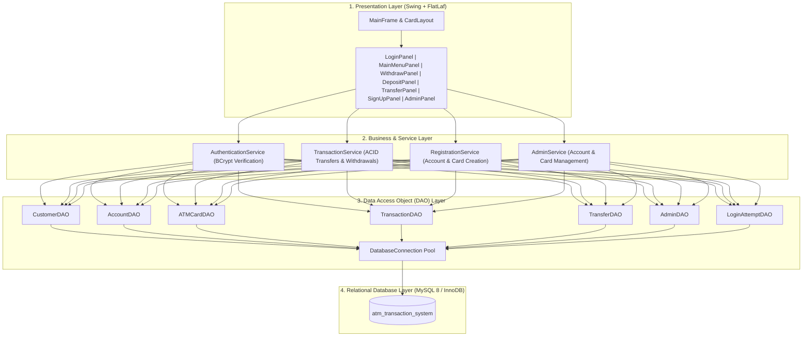
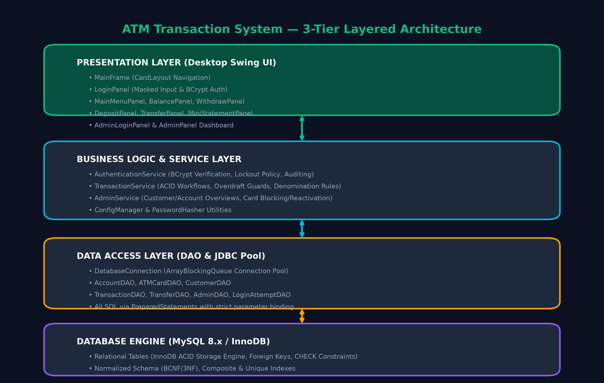
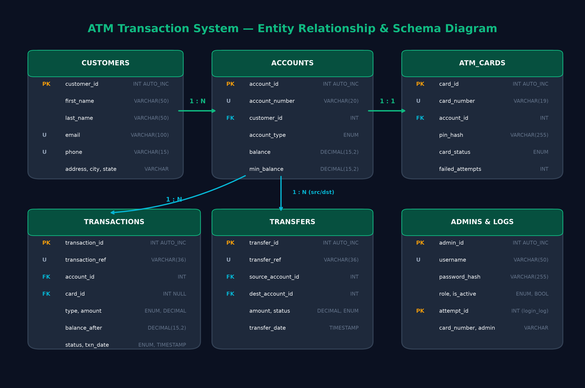

# 🏧 ATM Transaction System

<p align="center">
  
  
  
  
  
  
  
</p>

<p align="center">
  <strong>An enterprise-grade, ACID-compliant ATM simulation and banking management platform built with Java 21, Swing (FlatLaf Dark Theme), JDBC, and MySQL.</strong>
</p>

<p align="center">
  <a href="#-key-features">Features</a> •
  <a href="#-system-architecture">Architecture</a> •
  <a href="#-database-design--er-diagram">Database Design</a> •
  <a href="#-quick-start-guide">Quick Start</a> •
  <a href="#-demo-credentials">Demo Credentials</a> •
  <a href="#-automated-test-suite">Test Suite</a> •
  <a href="#-project-structure">Project Structure</a> •
  <a href="#-academic-deliverables">Deliverables</a>
</p>

---

## 🌟 Overview

The **ATM Transaction System** is a complete, production-ready desktop banking simulation designed to showcase robust database architecture, ACID transaction processing, multi-layer security, and modern UI engineering.

Engineered with a **3-Tier Layered Architecture** (Presentation, Service, Data Access), the application connects to a MySQL/MariaDB relational database using parameterized JDBC queries, protects sensitive credentials with **BCrypt hashing**, and provides a responsive dark-themed user interface powered by **FlatLaf**.

---

## 🚀 Key Features

### 👤 Customer ATM Experience
* **Touch-Optimized Modern Dark Interface**: Sleek UI with `CardLayout` navigation, responsive card styling, and animated feedback.
* **Smart Authentication & Brute-Force Defense**:
  * 4-digit PIN authentication verified against salted **BCrypt** hashes.
  * Real-time tracking of failed attempts with **automatic card locking** after 3 consecutive invalid entries.
* **Instant Balance Inquiry**: Real-time balance retrieval with account type and customer details.
* **Cash Withdrawal**:
  * Quick-cash presets (₹500, ₹1,000, ₹2,000, ₹5,000) and custom withdrawal entry.
  * Multi-tier validation: denomination checking (multiples of ₹100/₹500), minimum balance preservation, and overdraft prevention.
* **Cash Deposit**: Immediate account crediting with transaction receipt generation.
* **Atomic Fund Transfer (Inter-Account)**:
  * Transfer money securely between any two accounts in the system.
  * ACID-guaranteed atomic execution: both sender debit and recipient credit succeed together or roll back completely.
* **Mini-Statement & Transaction Ledger**:
  * Displays the 10 most recent transactions with unique reference codes (`TXN-...`), before/after balance snapshots, timestamps, and status badges.
* **New Customer Onboarding (Sign-Up)**:
  * Built-in registration dialog creating customer records, linked bank accounts, and automatically provisioning active ATM cards.

### 🛡️ Bank Administrator Portal
* **Separate Administrative Authentication**: Secure admin credential verification.
* **Customer & Account Portfolio**: Inspect all registered customers, account balances, and account statuses.
* **Card Management**: View card statuses (`ACTIVE`, `BLOCKED`, `EXPIRED`) and instantly unlock/reactivate blocked cards.
* **Transaction Auditing**: Global transaction oversight across all accounts with search and filtering.

---

## 🏛️ System Architecture

The project strictly follows the **3-Tier Layered Architecture** pattern ensuring clean separation of concerns, maintainability, and testability:



<p align="center">
  
</p>

---

## 🗄️ Database Design & ER Diagram

The database schema (`atm_transaction_system`) is strictly normalized to **3NF/BCNF** with foreign key referential integrity, unique constraints, and check constraints under the **InnoDB** storage engine.

<p align="center">
  
</p>

### Database Tables Summary

| Table | Primary Key | Description | Key Constraints |
| :--- | :--- | :--- | :--- |
| **`customers`** | `customer_id` | Demographics and personal records of account holders | `UNIQUE(email)`, `UNIQUE(phone)` |
| **`accounts`** | `account_id` | Bank accounts linked to customers with precision balances | `CHECK(balance >= 0)`, `FK(customer_id)` |
| **`atm_cards`** | `card_id` | ATM cards with BCrypt PIN hashes and security statuses | `UNIQUE(card_number)`, `FK(account_id)` |
| **`transactions`** | `transaction_id` | Immutable audit trail for all deposits, withdrawals, and transfers | `UNIQUE(transaction_ref)`, `FK(account_id)` |
| **`transfers`** | `transfer_id` | Inter-account fund transfers linking source and destination | `UNIQUE(transfer_ref)`, `FK(source_id, dest_id)` |
| **`login_attempts`**| `attempt_id` | Security audit log of card authentication successes and failures | `FK(card_number)` |
| **`admins`** | `admin_id` | Authorized bank personnel credentials and access levels | `UNIQUE(username)` |

---

## ⚡ Quick Start Guide

### Prerequisites
* **Java Development Kit (JDK)**: Version 21 LTS or higher installed and added to `PATH`.
* **Database**: MySQL 8.x Server or **XAMPP (MariaDB)**.

---

### Option A: One-Click Launch (Windows — Recommended)

The repository includes a zero-configuration launcher script ([`run.bat`](run.bat)) that automates everything:
1. Detects your running MySQL / MariaDB (or starts local XAMPP MariaDB automatically).
2. Auto-initializes the schema and sample dataset if the database is not yet set up.
3. Automatically sets up [`config.properties`](config.properties) from template.
4. Compiles the Java sources and launches the application GUI.

Simply double-click:
```cmd
.\run.bat
```
*(Or in PowerShell: `powershell -ExecutionPolicy Bypass -File .\start-atm.ps1`)*

---

### Option B: Manual Setup

#### 1. Clone the Repository
```bash
git clone https://github.com/vinay939251-png/ATM-Transaction-System.git
cd ATM-Transaction-System
```

#### 2. Import Database Schema & Sample Data
Log into MySQL:
```bash
mysql -u root -p
```
Run the setup scripts:
```sql
SOURCE database/schema.sql;
SOURCE database/sample_data.sql;
```

#### 3. Configure Database Credentials
Copy [`config.example.properties`](config.example.properties) to `config.properties`:
```properties
db.url=jdbc:mysql://localhost:3306/atm_transaction_system?useSSL=false&allowPublicKeyRetrieval=true&serverTimezone=UTC
db.username=root
db.password=your_password_here
```

#### 4. Build and Run

**Using Gradle:**
```bash
# Build
./gradlew build

# Run Application
./gradlew run
```

**Using Native Windows Scripts:**
```cmd
# Compile all sources to bin/
.\build.bat

# Launch the ATM Application
.\run.bat
```

---

## 🔑 Demo Credentials

The database comes pre-loaded with synthetic demo records:

### 💳 Customer ATM Cards
| Card Number | Customer Name | Account Type | Available Balance | PIN | Status |
| :--- | :--- | :--- | :--- | :---: | :---: |
| `4532-1234-5678-9010` | Aarav Sharma | Savings | ₹75,000.00 | **`1234`** | `ACTIVE` |
| `4532-3456-7890-1232` | Priya Reddy | Savings | ₹32,500.00 | **`1234`** | `ACTIVE` |
| `4532-4567-8901-2343` | Vikram Patel | Savings | ₹120,000.00 | **`5678`** | `ACTIVE` |
| `4532-7890-1234-5676` | Rohan Kumar | Savings | ₹5,000.00 | **`7890`** | `BLOCKED` *(Test Lock)* |

### 👨‍💼 Bank Administrator
* **Username**: `admin`
* **Password**: `admin123`

---

## 🧪 Automated Test Suite

The project includes an automated test suite verifying business logic, cryptographic hashing, concurrency handling, and ACID transaction rollbacks without requiring a live database connection.

To execute the test suite:
```cmd
.\test.bat
```
*Or using Gradle:*
```bash
./gradlew test
```

### Test Coverage Highlights
* **`PasswordHasherTest`**: BCrypt salt generation, verification accuracy, and rejection of invalid PINs.
* **`ConfigManagerTest`**: Reading properties, default fallbacks, and connection parameters.
* **`ModelTest`**: Object integrity, currency calculations, and balance mutations.
* **`ValidationTest`**: Input validation for account numbers, currency bounds, and pin length constraints.
* **`RegistrationServiceTest`**: New account opening, duplicate prevention, and initial card issuance.
* **`ATMSuiteTestRunner`**: Concurrency safety, race-condition mitigation, and transaction atomicity verification.

```text
============================================================
                   TEST EXECUTION SUMMARY
============================================================
  Total Tests Run : 45
  Passed          : 45
  Failed          : 0
  Pass Rate       : 100.0%
============================================================
  STATUS: ALL TESTS PASSED SUCCESSFULLY! (PASS)
============================================================
```

---

## 📁 Project Structure

```text
ATM-Transaction-System/
├── database/
│   ├── schema.sql                   # Normalized DDL schema (7 tables, InnoDB)
│   ├── sample_data.sql              # Synthetic sample records & verified BCrypt hashes
│   └── queries.sql                  # Analytical, audit, and reporting queries
├── docs/
│   ├── architecture_diagram.png     # 3-Tier Layered Architecture Diagram
│   ├── er_diagram.png               # High-resolution Entity Relationship Diagram
│   ├── report.tex                   # Official LaTeX Academic Course-End Report
│   ├── report.docx                  # Microsoft Word Project Report Document
│   └── project_specification.md     # Full academic project specification
├── lib/                             # Standalone dependency JARs (FlatLaf, BCrypt, MySQL Driver)
├── src/
│   ├── main/java/com/atm/
│   │   ├── ATMApplication.java      # Application bootstrap and entry point
│   │   ├── dao/                     # Data Access Objects (CRUD & prepared SQL statements)
│   │   ├── model/                   # Domain entities (Customer, Account, ATMCard, Transaction)
│   │   ├── service/                 # Business logic, BCrypt auth, and ACID transactions
│   │   ├── ui/                      # Swing panels, FlatLaf dark theme, and navigation
│   │   └── util/                    # Connection pooling, config manager, password hashing
│   └── test/java/com/atm/test/      # Automated test suites and verification runner
├── build.bat                        # Windows compile script
├── run.bat                          # One-click Windows launch script
├── test.bat                         # Automated test suite script
├── start-atm.ps1                    # PowerShell service orchestrator
├── build.gradle                     # Gradle configuration
└── config.example.properties        # Database connection configuration template
```

---

## 📊 Useful SQL Queries & Reports

Pre-crafted queries are available in [`database/queries.sql`](database/queries.sql) for database inspection and academic demonstration:
* **Q1**: Full customer portfolio and active accounts.
* **Q2**: ATM cards with failure counts and card states.
* **Q3**: Account transaction statement sorted newest first.
* **Q4**: Daily transaction volume and aggregate financial flows.
* **Q5**: Audit of high-frequency or suspicious login failures.
* **Q6**: Inter-account transfer audit ledger linking both debit and credit entries.
* **Q7**: Customer balance ranking and account tier classification.

---

## 🎓 Academic Deliverables

This repository serves as a complete Course-End Project submission for Database Management Systems (DBMS):
* **Project Specification**: Detailed in [`docs/project_specification.md`](docs/project_specification.md).
* **LaTeX Report**: Typeset academic report in [`docs/report.tex`](docs/report.tex).
* **Word Report**: Formatted document in [`docs/report.docx`](docs/report.docx).
* **Architecture & ER Diagrams**: High-res schematics in [`docs/`](docs/).

---

## 📄 License

This project is licensed under the [MIT License](LICENSE) - feel free to use, modify, and distribute for academic and personal learning purposes.

---

<p align="center">
  Developed by <a href="https://github.com/vinay939251-png"><strong>Vinay</strong></a>
</p>